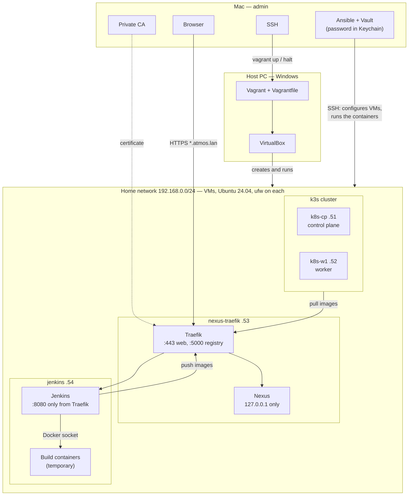

# atmos-ansible

Vagrant and Ansible for the on-premise platform of **Atmos**: creates the servers in VirtualBox and configures everything inside them.



Layers: Vagrant on the host PC creates the VMs, Ansible on the Mac configures everything inside them, and the tools run as Docker containers (Nexus, Traefik, Jenkins) or as k3s. All web access and the registry go through Traefik.

## Contents

| Path | What it does |
|---|---|
| `Vagrantfile` | The four VMs: pinned box, CPU, RAM, fixed addresses, start order; unique SSH host keys and the SSH key of the Mac on creation |
| `inventory/hosts.yml` | Servers with fixed addresses, groups `servers`, `docker`, `k3s`, and `localhost` (the Mac) |
| `group_vars/all/` | Shared names, hosts and ports (`platform.yml`), registry address, PKI paths, platform names, Mac addresses, pinned versions, secrets (Ansible Vault) |
| `roles/pki/` | The Mac: private CA and the wildcard certificate of the platform domain |
| `roles/common/` | All servers: base packages, time zone, `ufw`, registry name in `/etc/hosts`, swap file (outside the cluster), node-exporter |
| `roles/docker/` | `nexus-traefik`, `jenkins`: Docker Engine, pinned and held |
| `roles/nexus/` | `nexus-traefik`: Nexus container, admin password, Docker repository, maintenance tasks, push and pull users |
| `roles/traefik/` | `nexus-traefik`: Traefik container, HTTPS routes for Jenkins, Nexus and the registry |
| `roles/jenkins/` | `jenkins`: Jenkins container built from a pinned version of `atmos-jenkins`, secrets from Ansible Vault, trust of the private CA |
| `roles/k3s/` | `k8s-cp` (server), `k8s-w1` (agent): pinned k3s, `ufw` ports of the cluster, trust of the private CA, access to the registry, Traefik limits, kubeconfig on the Mac |
| `site.yml` | Applies everything in order; one tag per play |
| `vault-pass.sh` | Reads the Ansible Vault password from the macOS Keychain |

## Prerequisites (manual, once)

| Where | What |
|---|---|
| Host PC (Windows 11) | VirtualBox 7.2.22 and Vagrant 2.4.9, pinned with `winget pin` |
| Host PC | Memory Integrity (Core isolation) off and `bcdedit /set hypervisorlaunchtype off`, so VirtualBox runs without the Windows hypervisor |
| Host PC | OpenSSH Server: key login only (`PasswordAuthentication no`), firewall rule for port 22 only from the Mac, network profile Private |
| Host PC | VirtualBox machine folder on drive D: (`VBoxManage setproperty machinefolder "D:\VirtualBox VMs"`); VM disks are dynamic, 64 GB each |
| Host PC | A clone of this repository (only `git pull`, all changes on the Mac) |
| Host PC | windows_exporter 0.32.1 (metrics of the PC for Prometheus), pinned with `winget pin`; firewall rule `windows_exporter from the k3s nodes`: TCP 9182 only from `k8s-cp` and `k8s-w1`, profile Private |
| Router | DHCP pool outside the server addresses .51–.54; DHCP reservations for the Mac and the host PC |
| Mac | Ansible 14.6.0 (core 2.21.6), pinned with `brew pin` |
| Mac | kubectl 1.37.2 and Helm 4.3.2, pinned with `brew pin`; Homebrew before Docker Desktop in `PATH` (Docker Desktop ships its own kubectl) |
| Mac | SSH key `~/.ssh/atmos_admin` for the host PC and the servers |
| Mac | Ansible Vault password in the macOS Keychain (service `atmos-ansible-vault`); a backup copy outside the Mac |
| Mac | Backup of `~/.atmos/pki/ca.key` and `ca.crt` outside the Mac (created by `site.yml` on the first run) |

## Usage

```bash
# Host PC, in the repository folder (over SSH from the Mac)
git pull && vagrant up                                            # create and start the servers
vagrant halt k8s-w1 && vagrant halt k8s-cp && vagrant halt jenkins && vagrant halt nexus-traefik   # stop in reverse order

# Mac
ansible-playbook site.yml --ask-become-pass                       # configure the Mac and all servers
ansible-playbook site.yml --check --diff --ask-become-pass        # show the changes, change nothing
ansible-playbook site.yml --tags traefik                          # one part only (tags: mac, pki, common, docker, nexus, traefik, jenkins, k3s)
ansible-playbook site.yml --limit k8s-w1                          # one server only
ansible all -m ping                                               # access check
```

- Running `site.yml` again changes nothing on a correct server.
- `--ask-become-pass` is the sudo password of the Mac (the plays on the Mac change `/etc/hosts`); runs limited to the servers do not need it.
- `vagrant halt` with several names stops them in `Vagrantfile` order, so the reverse order needs one call per server.
- After `vagrant up`, wait about a minute before Ansible: the bridged network of a VM becomes reachable after it reports "ready".

**Memory:** the host has about 11 GB available for the servers. The four servers are allocated 11.5 GB, plus about 0.6 GB of VirtualBox overhead; the remaining ~1 GB is served from the host page file (SSD).

## Addresses

| Name | Served by | Reachable from |
|---|---|---|
| `https://jenkins.atmos.lan` | Traefik on `nexus-traefik` → Jenkins `:8080` on `jenkins` | home network |
| `https://nexus.atmos.lan` | Traefik → Nexus (only on `127.0.0.1:8081`) | home network |
| `nexus.atmos.lan:5000` | Traefik → Nexus Docker registry (only on `127.0.0.1:8082`) | `jenkins`, cluster nodes |
| `https://192.168.0.51:6443` | Kubernetes API on `k8s-cp` | the Mac, cluster nodes |

Names, hosts and ports are defined once in `group_vars/all/platform.yml` and `registry.yml`. The Mac gets the names in `/etc/hosts`; the servers get only the registry name.

Nexus users: `jenkins-push` (push and pull) and `cluster-pull` (pull only) on the repository `atmos-docker`; passwords in Ansible Vault. Nexus Community has no "keep the last N versions" cleanup: old tags are removed by hand; weekly tasks delete unused manifests and compact the blob store.

## Jenkins platform

`roles/jenkins` deploys the platform defined in [atmos-jenkins](https://github.com/Kernel-Club/atmos-jenkins): it clones the tag set in `jenkins_platform_version` (`group_vars/all/versions.yml`), builds the image `atmos-jenkins:<commit>` on `jenkins` and runs the container in the host network with the Docker socket of the server.

- **New platform version:** tag `atmos-jenkins`, set `jenkins_platform_version` to the tag, run `ansible-playbook site.yml --tags jenkins`. A branch name can be set there to test before a release.
- **Secrets:** `jenkins_secrets` in `roles/jenkins/defaults/main.yml` maps each `${NAME}` of the JCasC file to a value in Ansible Vault. Ansible places them in `/opt/jenkins/secrets` (read-only in the container as `/run/secrets`) and restarts Jenkins when a value changes.
- **New container** (new platform version or new server): Ansible restarts Jenkins once, because Jenkins loads the jobs created by JCasC only at the next start.
- **After a rebuild of `jenkins`:** configuration, credentials and the job come back by themselves; the build history is lost.

## Cluster (k3s)

`roles/k3s` installs k3s `k3s_version` (`group_vars/all/versions.yml`) with the installer of exactly that version: first the server on `k8s-cp`, then the agent on `k8s-w1`, which joins with the token of the server. The installer runs only when another version or none is installed.

- **Network:** k3s uses the bridged adapter (`eth1`); `eth0` is the Vagrant NAT with the same address on every VM. `ufw` allows the cluster ports only between the nodes, and the API also from the Mac.
- **Registry:** `/etc/rancher/k3s/registries.yaml` on both nodes: the read-only user `cluster-pull` and the private CA. `coredns-custom` adds `nexus.atmos.lan` for the pods, which do not read `/etc/hosts` of the node.
- **Traefik of k3s:** memory and node set in a `HelmChartConfig` in `/var/lib/rancher/k3s/server/manifests`.
- **Secrets:** the join token, the registry password and the kubeconfig are handled with `no_log`; files `0600`.
- **kubectl on the Mac:** Ansible writes `~/.kube/atmos.yaml` (context `atmos`, address of `k8s-cp`). Once, in fish: `set -Ux KUBECONFIG $HOME/.kube/config:$HOME/.kube/atmos.yaml`, then `kubectl config use-context atmos`.

## Certificates

`roles/pki` creates on the Mac, in `~/.atmos/pki` (outside the repository):

| File | Valid until | Used by |
|---|---|---|
| `ca.crt` / `ca.key` — Atmos Root CA | 2036-11-15 | trusted by the Mac, Docker on `jenkins` and the cluster nodes (later also Flux); the key never leaves the Mac |
| `atmos.lan.crt` / `.key` — `*.atmos.lan`, `atmos.lan` (SAN) | **2029-02-20** | Traefik |

Check the dates: `openssl x509 -in ~/.atmos/pki/atmos.lan.crt -noout -enddate`.
Renew the server certificate before it expires: delete `atmos.lan.crt` and run `ansible-playbook site.yml --tags pki,traefik --ask-become-pass`; the clients keep trusting it because the CA stays the same.

## Snapshots and rebuild

- **Snapshots:** `vagrant snapshot save clean` (all servers stopped, disk only) after the base configuration. Restore one server with `vagrant snapshot restore jenkins clean` or all with `vagrant snapshot restore clean`, then run `site.yml`.
- **Recreate a server:** `vagrant destroy -f <server>`, `vagrant up <server>`, then `site.yml`. A new VM has a new SSH host key: on the Mac run `ssh-keygen -R <address>` and connect once to accept the new key.
- **Whole platform:** follow the manual steps in [architecture.md](https://github.com/Kernel-Club/atmos-dev/blob/develop/docs/on-premise/architecture.md) (section 2).

## Known issues

| Issue | What to do |
|---|---|
| A VM hangs at boot: `vagrant up` times out, the console shows `rcu_preempt detected expedited stalls on CPUs` (VirtualBox vCPU stall) | `vagrant halt -f <server>`, then `vagrant up`; if this happened while the server was created, also `vagrant provision <server>` (Vagrant skips the provisioners after the hang, SSH then asks for a password) |
| Nexus Community sends daily telemetry; after 30 days without it the instance becomes read-only | Keep outgoing internet access on `nexus-traefik` |
| Ansible reports `Host key verification failed` after a server was recreated | `ssh-keygen -R <address>`, connect once |

## Secrets

Platform passwords are stored only encrypted with Ansible Vault (`group_vars/all/vault.yml`). The vault password stays in the macOS Keychain of the Mac; `vault-pass.sh` reads it (set in `ansible.cfg`), so no vault password prompt is needed. The CA key, kubeconfig, keys and `.env` files are never committed (see `.gitignore`).

## Related

| Repository | Role |
|---|---|
| [atmos-dev](https://github.com/Kernel-Club/atmos-dev) | Application and on-premise docs (`docs/on-premise/`) |
| [atmos-jenkins](https://github.com/Kernel-Club/atmos-jenkins) | Jenkins platform: image, plugins, configuration as code |
| [atmos-k8s](https://github.com/Kernel-Club/atmos-k8s) | Everything inside the cluster: Helm chart, Flux, monitoring |

Branching: `main` + `feature/*` / `fix/*` with a Pull Request ([branching model](https://github.com/Kernel-Club/atmos-dev/blob/develop/docs/on-premise/branching-model.md)).
